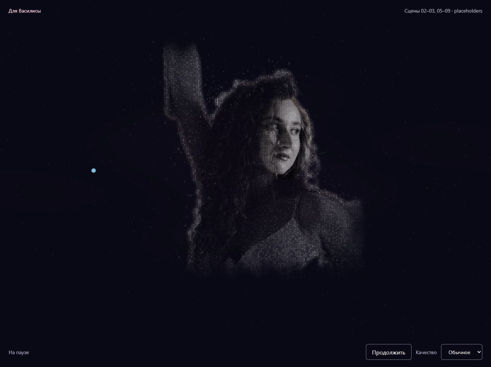
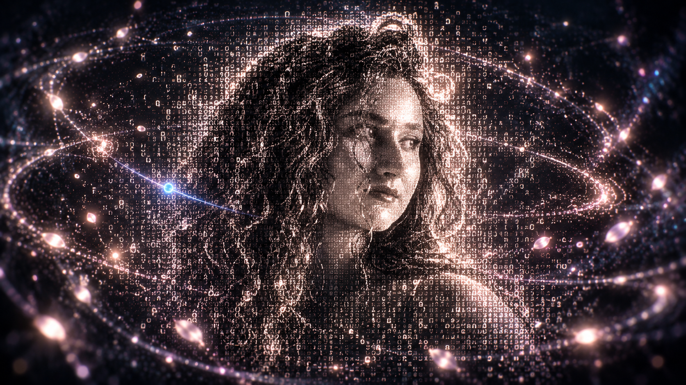

# 04.5 — узнавание лица, 17–23 с

Изменение от 2026-10-28 касается только 04.5. Сценарий: Storyboard v2.0,
кадр 04.5; художественное направление: `key_frames/S04_F05_ASCIIPortrait.png`.
Референс задаёт объём, растворение и свет; черты лица берутся только из фото.

## Источник и реализация

- Оригинал: `images/start_img.jpg`, runtime-копия: `frontend/src/assets/start_img.jpg`.
  SHA-256 обеих копий до и после работы:
  `befad4fd1f270558eeab25113bb169ed25479ce7b7cb3db7812fdce29124d899`.
  Фото не заменено и не ретушировалось.
- Существующий `makeAscii()` в `IdentityScene.tsx` рисует 112×112 символов на
  CanvasTexture. Он сохранён для соседних кадров. `particleGeometry()` также
  продолжает брать яркость из этого фото для прежнего морфинга.
- В 04.5 `CosmicPortraitField.tsx` временно заменяет плоскость двумя отрисовками:
  GPU-символами и слабо видимым маскированным слоем оригинала для микродеталей.
  Новая alpha-only маска `start_img.matte.png` (6667 байт) получена GrabCut из
  этого фото. Она убирает стену по фотографическому контуру. Внешние края кадра
  дополнительно растворяются неравномерно; у волос остаются отдельные символы.
- Плотность и тон зависят от яркости и контраста исходных пикселей. Контровой
  свет строится из градиента маски, без Bloom. Блики не перекрывают глаза.
- Последовательность: волосы/силуэт → глаза → нос → губы → плечи.
  Окна отдельных ячеек сдвинуты детерминированным seed. К 21.3 с движение
  затихает. Координаты лица не деформируются: глубина компенсируется в проекции;
  свободные смещения разрешены периферийным символам.
- Отдельная голубая частица-проводник удалена; фоновая пыль
  приглушается перед лицом. Эффект плавно входит в 17–17.65 с и отдаёт управление
  прежнему изображению в 22.4–23 с. В 23 с параметры 04.6 совпадают с прежними;
  его прямоугольная фотография постепенно возвращается при этом стыке.

## Проверка рядом с референсом

1. Из `frontend/` выполнить `npm run dev` либо использовать уже работающий
   сервер. Открыть `http://127.0.0.1:5173/?debug`.
2. DEV → «Сцена» → «Василиса» → «Запустить сцену» → «Пауза».
3. Перемещать «Время сцены»: 17.2, 18.2, 19.2, 20.8, 21.8, 22.5, 23 с.
   Скрывать DEV для просмотра. Сравнивать узнаваемость с исходным фото,
   а растворение и свет — с референсом. Проверить стыки 16.9→17 и 23→24 с.
4. Повторить быстрые скачки 28→0→23→17.1→22.9→13→20.8, медленный scrub
   17→23, перезапуск, низкое качество и портретную ориентацию.

| Реализация на 20.8 с | Художественный референс |
| --- | --- |
|  |  |

[Ранняя стадия на 18.2 с](verification/scene-04-5/portrait-18.2.png).

## Проверено

- `npm run check`: ESLint, 119 тестов в 30 файлах, TypeScript, production build.
- Изолированный Chrome: обычное/низкое качество, 1366×1024 и 768×1024,
  reduced motion, отсутствие ошибок браузера и компиляции шейдеров.
- Скриншоты 20.8 с побайтно совпали после быстрого, обратного и медленного seek
  (шаг 0.1 с), а также после перезапуска. Проверяет
  `frontend/scripts/review-portrait.mjs` через существующие DEV-контролы.
  Запуск из `frontend/`: `node scripts/review-portrait.mjs <путь-к-playwright> <папка-снимков>`.
  Playwright нужен только для этой дополнительной проверки, зависимости приложения
  не изменялись.
- Новая маска включена в обязательный production runtime manifest с размером и SHA-256.
- Механический Impeccable detector: замечаний нет; рендер просмотрен вручную.

Существующие предупреждения сборки: Three.js CommonJS deprecated и App chunk >500 kB.
Физический iPad/Safari и производительность при одновременной записи не проверены.
Для символов используются сетки до 144² (обычное) / 112² (низкое), с отсевом
пустых ячеек и небольшим числом символов контура. Буферы создаются один раз,
движение вычисляет шейдер от общего времени; ресурсы освобождаются при смене
качества/размонтировании. Дополнительных рендереров и покадрового React state нет.

Пересоздание маски: `python frontend/scripts/generate-portrait-matte.py` из корня;
нужны OpenCV и NumPy только на этапе подготовки. Скрипт проверяет хеш оригинала
и пишет отдельную маску, не изменяя фотографию.
