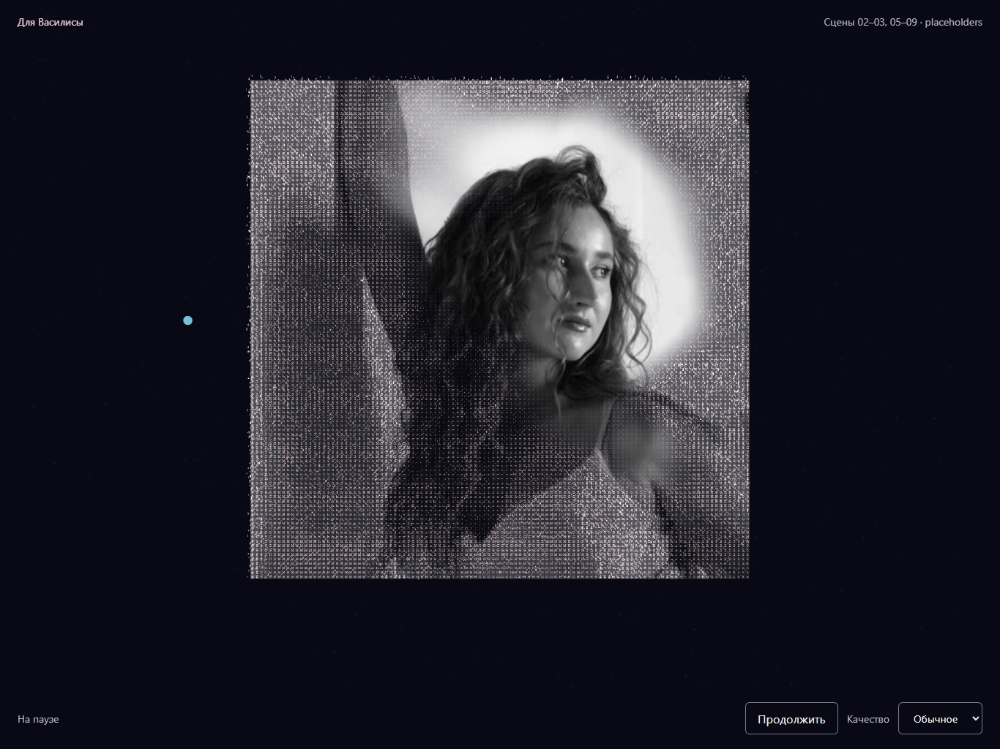

# 04.6 — восстановление оригинальной фотографии

2026-10-28. Интервал: 23–28 с сцены 04, Storyboard v2.0, кадр 04.6.
Источник: `images/start_img.jpg`; runtime: `frontend/src/assets/start_img.jpg`.
Это чёрно-белая фотография 640×640, без колоризации, ретуши и смены кропа.
Обе копии сохранили SHA-256
`befad4fd1f270558eeab25113bb169ed25479ce7b7cb3db7812fdce29124d899`.

## Что изменилось

Прежний переход равномерно убирал символы и увеличивал прозрачность фото.
Теперь три неровных фронта от лица, волос и плеча локально восстанавливают
фотографию. ASCII-плоскость, объёмные символы и фото читают одну карту времени
восстановления в исходных UV. За фронтом исчезают символы; на самом фронте
тонкая пиксельная структура мягко возвращается к точному семплу оригинала.
UV, размеры плоскости, центр и камера не меняются.

К 26.8 с все пиксели восстановлены. До конца кадра остаётся спокойная пауза:
редкая замедленная пыль, слабая окантовка за фотографией. Цветное марево
приглушено, голубая частица временно отведена влево от лица. Окантовка намечает
пространственную карточку без раннего появления подписи и движения камеры 04.7.
В конце временные изменения среды плавно сходят к прежнему состоянию 28 с.

Карта 112×112 RGBA занимает 50 176 байт; создаётся один раз. Время берётся из
общего runtime, поэтому перемотка не накапливает симуляцию. Карта, материалы
фото и окантовки освобождаются при размонтировании. Новых библиотек,
постпроцессинга, изображений лица или WebGL-рендереров нет.

## Сравнение с референсом

В референсе лицо становится реальным раньше окружающих символов; это основной
ритм новой версии. Сияние здесь спокойнее, а поза, фон и чёрно-белые тона
соответствуют исходному фото. Референс не используется как текстура.

| Реализация, 24.5 с | Референс 04.6 |
| --- | --- |
|  |  |

[Завершённое фото, 26.8 с](verification/scene-04-6/photo-26.8.png) ·
[Портретный планшет, 27.5 с](verification/scene-04-6/portrait-tablet-27.5.png).

## Как проверить

1. Из `frontend/`: `npm run dev` или использовать работающий сервер.
2. `http://127.0.0.1:5173/?debug` → «Василиса» → «Запустить сцену» → «Пауза».
3. Проверить 23, 23.6, 24.5, 25.5, 26.8, 27.5, 28 с. Скрыть DEV при сравнении.
   На 24.5 с лицо уже раскрыто, периферия ещё цифровая. На 26.8 с символов нет.
4. Проверить скачки назад/вперёд, медленный scrub с шагом 0.1 с и перезапуск.
   Повторить в низком качестве и при портретном размере окна.

Автоматическая браузерная проверка из `frontend/`:
`node scripts/review-photo.mjs <путь-к-playwright> <папка-снимков>`.
Опция `--capture-only` сохраняет только основные контрольные кадры.
Playwright требуется только для этого инструмента; зависимости приложения не менялись.

## Результаты проверки

- `npm run check`: ESLint, 123 теста в 31 файле, строгий TypeScript, production build.
- Изолированный Chrome: 1366×1024 и 768×1024, обычное/низкое качество,
  reduced motion. Ошибок браузера и компиляции GLSL нет.
- На 24.5 с скриншоты после быстрого/обратного seek, медленного seek 23→28
  с шагом 0.1 с и перезапуска побайтно совпали.
- Сравнение с сохранённой версией до правок: скриншоты 20.8, 22.3, 23, 28,
  28.1 и 30 с побайтно идентичны. Код камеры, тайминги и `identityFrame` не менялись.
- В области лица на финальном фото максимальная разница R/G/B равна 0.
  Пропорции фото в двух ориентациях сохранены; в 768×1024 оно помещается целиком.
- Impeccable detector: замечаний нет; снимки просмотрены вручную рядом с референсом.
- Сохраняются прежние предупреждения Three.js CJS deprecated и App chunk >500 kB.
  Физический iPad/Safari, DPR 2 и одновременная запись реакции не проверялись.

## Файлы этой задачи

- `frontend/src/scenes/IdentityScene.tsx` — карта восстановления, материалы,
  синхронизация слоёв и временная траектория голубой частицы.
- `frontend/src/scenes/shared/identityRestoration.ts` — расписание фронтов,
  shared GLSL, пиксели оригинала и слабая окантовка.
- `frontend/src/scenes/shared/identityRestoration.test.ts` — границы,
  монотонность восстановления, пространственная последовательность и пауза.
- `frontend/src/scenes/shared/identityMorph.ts` — локальное замещение ASCII.
- `frontend/src/scenes/shared/FirstMemoryCard.tsx` — опциональные материалы
  фото/окантовки для сцены identity; галерея использует прежний материал.
- `frontend/src/scenes/shared/IdentityAtmosphere.tsx` — временное успокоение пыли
  и марева только внутри 04.6.
- `frontend/scripts/review-photo.mjs` — браузерная проверка и снимки.
- `docs/scene-04-6-vfx.md` — этот отчёт.
- `docs/verification/scene-04-6/restoration-24.5.png`, `photo-26.8.png`,
  `portrait-tablet-27.5.png` — контрольные снимки вне runtime bundle.

Прочие незакоммиченные файлы проекта и работа предыдущих задач сохранены.
