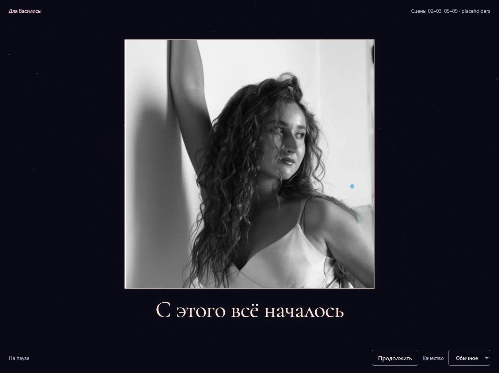

# 04.7 — первое воспоминание и вход в галерею

2026-10-28. Доработан интервал 28–34 с сцены 04 и необходимый стык с 05.1.
Источник: Storyboard v2.0, разделы 04.7, 05.1–05.2 и 05.5;
художественный ориентир — `key_frames/S04_F07_FirstMemory.png`.

## Изображения и ограничение галереи

Для воспоминаний предоставлен только `images/start_img.jpg` (runtime-копия
`frontend/src/assets/start_img.jpg`). Остальные фотографии в `images/` —
крупные планы глаза для сцены 06. Они не превращены в выдуманные воспоминания.
Ключевые кадры и скриншоты также не используются как фотографии галереи.
Хеш исходника и runtime-копии сохранён:
`befad4fd1f270558eeab25113bb169ed25479ce7b7cb3db7812fdce29124d899`.

`MEMORIES` теперь содержит одно настоящее воспоминание вместо пяти пустых
карточек рядом с первым фото. В 04.7 нет UI-заглушек. В 05 можно рассматривать
первое фото без ограничения времени, ставить паузу, касаться его и продолжать
историю. Свайп не уводит в пустоту; кнопки соседних фото отключены при их отсутствии.
Механизм фокуса камеры, обработчик swipe и reducer навигации сохранены.
Pinch-to-zoom, которого в текущей реализации не было, этой задачей не добавлялся.

Для финальной галереи нужны **ещё 4–6 реальных фотографий** (до запланированных
5–7 воспоминаний), их порядок, короткие личные подписи и выбранный кроп для
каждого снимка. Каждое изображение необходимо отдельно подключить как runtime
asset; одной записи в `MEMORIES` недостаточно. Истории и лица не генерировались.

## Художественное изменение

- Фото остаётся главным объектом. Толстая светлая рамка заменена тонкой кромкой,
  узкой подложкой с глубиной и слабым тёплым ореолом. Редкие искры у края и
  пыль на разных расстояниях дают перспективу без засветки лица и Bloom.
- В 28–29.4 с 360 частиц, взятых из штрихов того же Georgia-имени «ВАСИЛИСА»,
  собираются в буквы подписи. Это редкий остаток, без повторного показа имени.
  Затем остаётся крупный DOM-текст Cormorant Garamond из уже имеющегося локального
  шрифта. Подпись находится ниже фотографии, а не поверх лица.
- До 31 с фото удерживается для чтения. В 31–34 с оно плавно отдаляется,
  слегка поворачивается, камера отъезжает и смещается вбок: появляется мягкий
  параллакс. Впереди и позади фотографии остаётся редкий световой объём.
- Конечная камера `(0.14, 0.04, 6.15) → (0, 0, 0)`, масштаб 1 и поворот фото
  `(-0.022, 0.065, -0.009)` общие для identity и начала gallery. В reduced motion
  параллакс/поворот выключены, подпись появляется проще. Текст доступен и при
  невозможности получить Canvas2D-контекст.

| Реализация, 31 с | Референс |
| --- | --- |
|  |  |

В референсе уже много других фотографий. Здесь сохранён честный ограниченный
переход с одним предоставленным снимком, без искусственных копий воспоминаний.

[Конец отъезда, 34 с](verification/scene-04-7/gallery-handoff-34.png) ·
[Портретный планшет](verification/scene-04-7/tablet-portrait-31.png).

## Проверка

- `npm run check`: ESLint, 126 тестов в 32 файлах, строгий TypeScript и production build.
- Chrome, стандартное/низкое качество, 1366×1024, 1024×768, 768×1024;
  reduced motion. Глифы подписи помещаются в viewport. Ошибок браузера/GLSL нет.
- На 32.5 с изображения после быстрых скачков, обратного seek, медленного
  scrub 28→34 с шагом 0.1 с и перезапуска побайтно совпали.
- Вход из 04.6: снимки 24.5, 26.8 и ровно 28 с побайтно совпали с версией до этой задачи.
- Выход в 05: world/projection matrices камеры и world matrix фото совпали
  с точностью 1e-8. После исключения DOM-оверлеев изображения WebGL на 34 с
  identity и при входе gallery побайтно идентичны.
- Проверены пауза/продолжение, касание фото, touch swipe вверх/вниз на границах
  единственного воспоминания и кнопка выхода в сцену eye.
- Impeccable detector: замечаний нет; результат просмотрен рядом с референсом.
- Существующие предупреждения: Three.js CJS deprecated и App chunk >500 kB.
  Физический iPad/Safari, DPR 2 и одновременная запись реакции не проверены.

GPU-объём: 220 точек standard / 100 low, из них 28 искр кромки; одна отрисовка.
Мягкая кромка — процедурная CanvasTexture 512² (~1 МиБ RGBA до mipmaps),
создаётся один раз и освобождается при размонтировании. Canvas2D подписи рисует
360 точек только во время сборки, без собственного requestAnimationFrame.
Все подписки/ResizeObserver, буферы, материалы и текстура имеют cleanup.

## Как посмотреть

Из `frontend/` выполнить `npm run dev` или использовать работающий сервер.
Открыть `http://127.0.0.1:5173/?debug` → «Василиса» → запуск → пауза.
Проверять 27.9, 28.5, 29, 31, 32.5, 34 с; скрывать DEV для сравнения.
На 34 с нажать «Пропустить сцену» для перехода в галерею и проверить отсутствие
скачка фото. Автоматический проход:
`node scripts/review-memory.mjs <путь-к-playwright> <папка-снимков>`.

## Файлы этой задачи

- `frontend/src/scenes/IdentityScene.tsx`, `GalleryScene.tsx` — общая пространственная подача, удаление пустых карточек.
- `frontend/src/scenes/shared/firstMemoryFrame.ts`, `firstMemoryFrame.test.ts` — общая хореография и её границы.
- `frontend/src/scenes/shared/FirstMemorySpace.tsx` — единый световой объём и искры кромки.
- `frontend/src/scenes/shared/FirstMemoryCard.tsx` — тонкая кромка, объём подложки и мягкий ореол.
- `frontend/src/scenes/shared/identityFrame.ts` — удержание масштаба до 31 с и плавное отдаление.
- `frontend/src/engine/CameraDirector.tsx` — отъезд камеры и непрерывный вход в 05.
- `frontend/src/engine/filmConfig.ts`, `film.test.ts` — каталог только доступных фото и актуальные проверки границ.
- `frontend/src/components/FirstMemoryCaption.tsx`, `SceneOverlay.tsx`, `frontend/src/app/styles.css` — формирование/типографика подписи и ограниченная навигация.
- `frontend/scripts/review-memory.mjs` — воспроизводимый браузерный проход.
- `docs/architecture.md`, `docs/scene-04-7-vfx.md`, три PNG в `docs/verification/scene-04-7/` — документация и контрольные кадры вне runtime bundle.

Другие незакоммиченные изменения и исходные фото сохранены.
